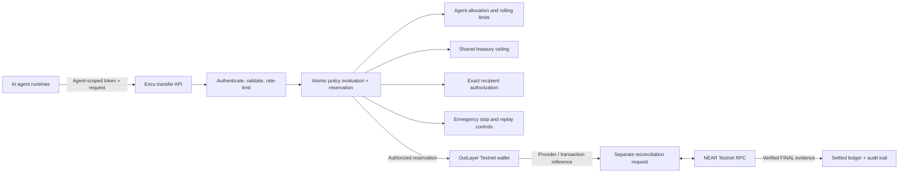

# Encu

**An independent authority and transaction-control layer for autonomous-agent payments.**

Encu authenticates logical agents, enforces application-level spending authority, reserves shared treasury exposure before execution, and verifies payment outcomes before settling its ledger. V1 demonstrates this model for native NEAR Testnet transfers through OutLayer.

**NEAR Hackathon 2026 · Track 06: AI Security & Defense**

[Product vision and roadmap](docs/ROADMAP.md) · [Developer guide](docs/DEVELOPER_GUIDE.md) · [Architecture](docs/ARCHITECTURE.md) · [Security model](docs/SECURITY_MODEL.md) · [Demonstration guide](docs/DEMO_RUNBOOK.md)

---

## The problem

An autonomous agent with direct access to a payment wallet can spend beyond its intended authority, send funds to an unintended account, or repeat a payment after a timeout. Wallet-level controls are important, but they do not necessarily express the distinct spending authority of several logical agents sharing one execution wallet.

Encu adds an independently enforced policy and accounting layer between agent runtimes and execution infrastructure. It determines which logical agent is making a request, what that agent is allowed to spend, which destinations are authorized, whether the shared treasury has capacity, and what evidence is required before the payment is recorded as settled.

## How V1 works



The database reservation is the control point: treasury and agent exposure are reserved atomically before provider submission is allowed. Reconciliation is a separate lifecycle step; provider acceptance alone does not settle the ledger. Exposure paths use the lock order **treasury row → allocation row → reservation row**.

## What V1 enforces

- Agent-scoped bearer authentication. The authenticated credential determines the logical agent identity.
- Shared treasury ceiling and per-agent allocations.
- Per-transfer limits and daily/weekly rolling spend limits.
- Configured autonomous spending allowance and administrator review for requests outside that allowance.
- Exact NEAR account recipient authorization.
- Atomic reservation of shared treasury and agent exposure.
- Idempotency and changed-payload replay protection.
- Emergency stop and persistent per-agent request rate limiting.
- Submission revalidation against current policy and recipient state.
- NEAR finality reconciliation against the expected signer, recipient, native transfer action and exact yoctoNEAR amount.
- Audit and security-event records.

## Current deployment boundary

Encu V1 is a **NEAR Testnet prototype** using one configured OutLayer execution wallet and one server-side OutLayer API credential shared by multiple independently authenticated logical agents.

Developers can create accounts in the developer workspace and manage logical agent identities, credentials and configured policy. These are application-level identities and allocations. They are **not** separate OutLayer principals or isolated custody wallets. OutLayer supplies the configured shared custody, signing and submission path.

V1 does **not** provide independent customer custody, isolated customer wallets, a native NEAR treasury contract, multiple implemented execution providers, NEAR Intents, mainnet support or independent transfer-bound TEE attestation verification. It has not undergone an independent formal security audit. See the [Security Model](docs/SECURITY_MODEL.md) for the threat model and limitations.

## Product direction

Encu is designed to keep policy and accounting independent from the execution provider. OutLayer is the current V1 provider, not a permanent product dependency. The intended direction is a stable execution-adapter boundary, with future evaluation of a native NEAR treasury contract, NEAR Intents, token and contract-based payments, additional providers, and a developer API/SDK.

These are roadmap directions, not implemented V1 capabilities or delivery promises. Each integration must preserve exact authorization, concurrency-safe reservations, verifiable execution evidence and safe settlement. See [Product Vision and Roadmap](docs/ROADMAP.md).

## Run locally

Use a dedicated disposable Supabase project and a dedicated OutLayer Testnet wallet. Never use production credentials or a wallet holding valuable assets.

1. Install Node.js compatible with the Next.js 15 application.
2. Clone the repository and install dependencies:
   ```bash
   npm install
   ```
3. Copy `.env.example` to `.env.local`.
4. Configure the variables in `.env.example`. The developer workspace requires `NEXT_PUBLIC_SUPABASE_URL` and `NEXT_PUBLIC_SUPABASE_PUBLISHABLE_KEY`; server operations require `SUPABASE_URL`, a server-side Supabase service-role key, and the configured OutLayer/NEAR Testnet values. Keep all service-role, administrator, agent and provider credentials server-side.
5. For a **brand-new, empty Supabase project only**, review and apply `supabase/setup.sql`. It is the consolidated fresh-install script. Do not also apply the dated upgrade scripts to that fresh database. Do not use the older `supabase/schema.sql` as the current V1 setup.
6. For an existing database, do **not** rerun `supabase/setup.sql`. Use the applicable dated upgrade scripts only after reviewing the database's current migration state. Never apply every SQL file indiscriminately.
7. Start the application:
   ```bash
   npm run dev
   ```
8. Open `http://localhost:3000/developers`. Create or sign in to a developer account using Supabase Auth. Account confirmation behavior depends on the Supabase project's email-auth settings. The workspace provisions logical agents; newly created agents start with zero allocation.

The Testnet request path can initiate a real Testnet transfer when policy permits it. Generating a payload does not submit a transfer. Explicit submission can move Testnet funds. Follow the [Developer Guide](docs/DEVELOPER_GUIDE.md) and [Demonstration Guide](docs/DEMO_RUNBOOK.md).

## Verification

The repository provides these checks:

```bash
npm run lint
npx tsc --noEmit
npm run build
npm run test:agent-api
npm run test:reconciliation
```

The Agent API and reconciliation suites use mocked provider/RPC services. They verify application behavior under test fixtures; they do not prove live OutLayer behavior or a hosted end-to-end transfer.

The reservation concurrency test uses a real Supabase database and mutates test rows and budget counters. Run it only against a dedicated disposable test project after reviewing the script:

```bash
AGENTGUARD_TEST_DATABASE=true npm run test:reservation-concurrency
```

## Documentation

| Document | Purpose |
|---|---|
| [Product vision and roadmap](docs/ROADMAP.md) | Product intent, V1 boundary, target architecture and future integration directions |
| [Developer guide](docs/DEVELOPER_GUIDE.md) | Developer workspace, agent credentials, request format, reconciliation and safe retries |
| [Architecture](docs/ARCHITECTURE.md) | Current components, target adapter boundary, trust boundaries and settlement rules |
| [Security model](docs/SECURITY_MODEL.md) | Assets, threats, mitigations, evidence and limitations |
| [Demonstration guide](docs/DEMO_RUNBOOK.md) | Human-readable preparation, presenter procedure, expected results and troubleshooting |
| [Submission checklist](docs/SUBMISSION_CHECKLIST.md) | Hackathon submission requirements and release checks |
| [V1 security implementation](docs/V1-SECURITY-IMPLEMENTATION.md) | Implementation-level security details |
| [OutLayer V1 backlog](docs/outlayer-v1-backlog.md) | Provider-specific constraints and unresolved operational work |

## Release verification status

The merged Request Payload Builder compatibility fix is present in `main` (PR [#8](https://github.com/BigWave45/agentguard/pull/8), merge commit `ec0b849043e7735ffb0e3e1b6a8043578d42708f`). Its CI run passed dependency audit, lint, type-check, production build, Agent API security/lifecycle tests and NEAR finality reconciliation tests.

The previously available Vercel Preview predates that merge. A deployment of the merged commit was blocked by the team's daily deployment limit. Therefore, the latest merged code has **not yet received fresh hosted browser verification**. Do not treat an older Preview as proof of the current `main` build.

---

**Repository identifiers:** internal package and code references retain `agentguard` / `AgentGuard`; the product name is **Encu**.
