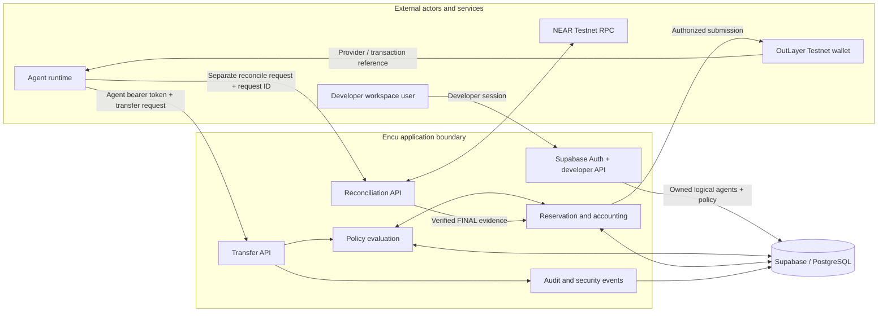
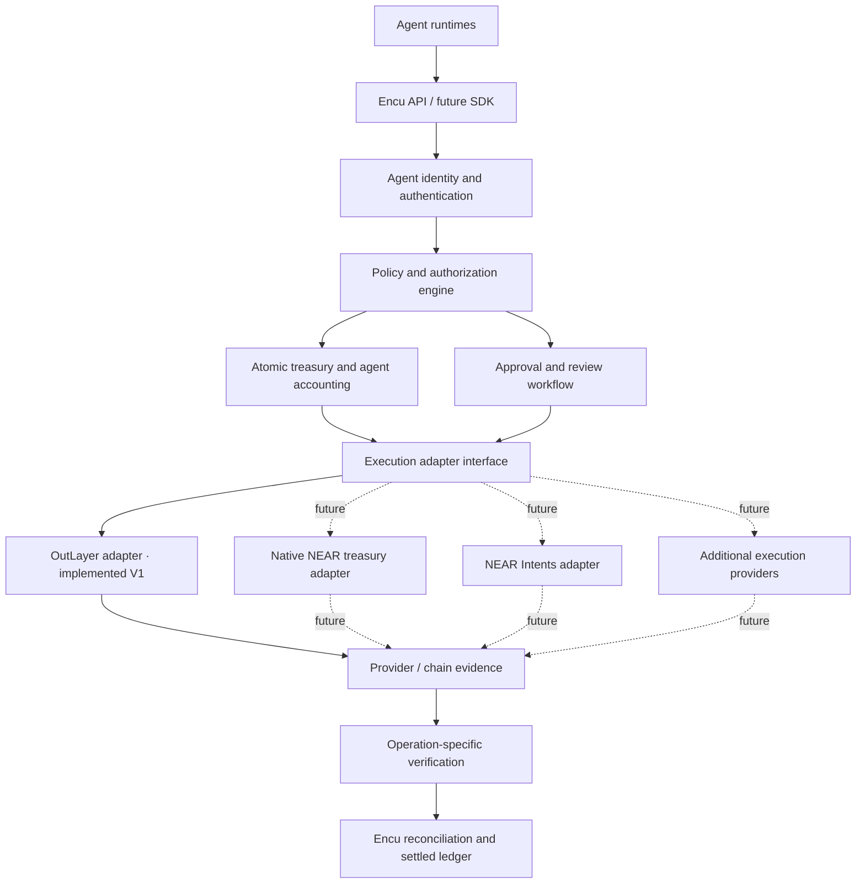

# Encu Architecture

## 1. Architectural purpose

Encu separates **payment authority and accounting** from the infrastructure that holds keys, signs transactions and submits them. Its policy layer determines whether an authenticated logical agent may initiate a payment. An execution adapter carries an authorized request to a provider. A reconciliation layer verifies the resulting transaction before the internal ledger is settled.

This separation is the product's architectural direction. The current V1 implementation is narrower: one OutLayer-backed native NEAR Testnet execution path and NEAR RPC reconciliation.

## 2. Implemented V1 system context



### Component responsibilities

| Component | Responsibility |
|---|---|
| Developer workspace | Supabase Auth signup/sign-in; provisions and manages developer-owned logical agents, allocations, policies and recipient permissions. |
| Agent runtime | Requests a payment using its agent-scoped bearer credential. The credential, not request-body data, establishes logical agent identity. |
| Transfer API | Validates request shape, authenticates the agent, applies rate limits and coordinates policy reservation and provider submission. |
| Policy and reservation logic | Evaluates agent and treasury authority, recipient permission, emergency state, idempotency and autonomous allowance. |
| PostgreSQL | Persists developer ownership, policies, allocations, treasury exposure, reservations, audit and security events. Atomic database functions protect exposure invariants. |
| OutLayer | Supplies the configured Testnet wallet custody, signing and transaction-submission path shared by logical agents in V1. |
| Reconciliation API and NEAR RPC | A separate reconciliation request queries NEAR transaction evidence and verifies finality and transfer details before ledger settlement. |

## 3. Authorization and execution sequence

The transfer endpoint and reconciliation endpoint are separate requests. The first may submit through OutLayer and return a `needs_review` lifecycle state with a transaction hash or provider request reference. The agent or operator then calls the reconciliation endpoint with the same request ID.

```mermaid
sequenceDiagram
    participant Agent as Agent runtime
    participant API as POST /api/agent/transfer
    participant DB as PostgreSQL
    participant OL as OutLayer
    participant Reconcile as POST /api/agent/reconcile
    participant RPC as NEAR Testnet RPC
    Agent->>API: Transfer request + agent bearer token
    API->>API: Authenticate, validate and rate-limit
    API->>DB: Atomic policy evaluation and reservation
    DB->>DB: Check allocation, treasury, recipient, limits, stop and replay
    DB-->>API: Denied, awaiting approval, or authorized reservation
    alt Denied
        API-->>Agent: 403 policy denial
    else Awaiting approval / replay
        API-->>Agent: 409 with lifecycle status; no new provider submission
    else Authorized
        API->>DB: Revalidate policy and claim submission
        DB-->>API: Submission claim granted
        API->>OL: Submit native NEAR transfer
        OL-->>API: Provider response / transaction reference
        API-->>Agent: 202 needs_review + request / provider reference
        Agent->>Reconcile: POST requestId + agent bearer token
        Reconcile->>DB: Load reserved transfer and provider reference
        Reconcile->>RPC: Query transaction with wait_until FINAL
        RPC-->>Reconcile: NEAR transaction evidence
        Reconcile->>Reconcile: Verify signer, receiver, single transfer action, amount and FINAL
        Reconcile->>DB: Settle reservation exactly once
        Reconcile-->>Agent: executed / failed, or 202 needs_review
    end
```

A provider response is not proof of payment. The reconciliation endpoint may return a pending/review result while a transaction hash is unavailable or NEAR evidence cannot yet be verified. Settlement requires matching NEAR FINAL evidence.

## 4. Policy and accounting model

A transfer must satisfy the applicable controls:

- authenticated agent identity;
- active agent status;
- agent allocation and per-transfer limit;
- daily and weekly rolling spend limits;
- configured autonomous allowance or approval requirement;
- exact recipient authorization;
- shared treasury ceiling;
- emergency-stop state;
- persistent request rate limit;
- idempotency and changed-payload replay protection.

The reservation transaction protects shared exposure under concurrency. Exposure paths follow the lock order:

**treasury row → allocation row → reservation row**

The shared treasury ceiling and agent allocation are separate constraints. A request that fits an agent's allocation can still exceed the global ceiling. A budget does not implicitly authorize a destination.

## 5. Target architecture: provider-independent control plane

The following diagram describes the intended extension boundary. Dashed connections are future integrations, not implemented V1 paths.



The adapter interface is intended to isolate provider-specific execution details. It must not move agent policy, shared-budget reservation or approval semantics into an adapter. Each future adapter must define its own idempotency mapping, submission state, transaction evidence, ambiguity recovery and verification rules.

A provider's acceptance response cannot settle Encu's ledger. The verification layer must establish that the executed operation matches the original authorized request. For token, swap, cross-chain or contract operations, verification must be operation-specific; checking only a transaction hash is insufficient.

## 6. Integration boundaries and roadmap

### OutLayer

OutLayer is the current V1 custody, signing and native NEAR Testnet submission provider. It also has its own wallet-level policy capabilities. Those provider controls are a defense-in-depth boundary and are distinct from Encu's per-agent allocations and shared application ledger.

The current integration does not create, read back or verify the effective OutLayer owner policy as part of every request. It also does not fetch, store or independently verify transfer-bound TEE attestations.

### Native NEAR treasury

A future treasury contract could enforce selected controls on-chain for funds held by that contract. It would need its own authorization, allocation, recipient, pause, replay and settlement design. This work is deferred from V1.

### NEAR Intents and other payment rails

The current adapter does not call NEAR Intents endpoints. Future Intents, token, DEX, escrow and cross-chain flows require exact binding between the authorized request and the asset, amount, destination and quote/route or execution artifact. They must not be represented as supported until implemented and verified.

### Developer interface

The current product provides a Supabase Auth developer workspace and HTTP transfer/reconciliation APIs. A common SDK and provider-neutral developer interface are future directions, not current deliverables.

See [Product Vision and Roadmap](ROADMAP.md) for the broader product rationale and planned integration directions.

## 7. Trust boundaries and V1 limitations

- Developer sessions, agent bearer tokens, administrator credentials, Supabase service-role credentials and OutLayer API credentials have different privileges and must remain separate.
- Agent bearer tokens authenticate logical agents; they do not grant direct OutLayer access.
- The server-side OutLayer credential and configured wallet are shared across V1 logical agents.
- Agent allocations are application-level ledger limits, not independent on-chain balances.
- OutLayer has its own wallet policy engine; its configured policy must not be assumed to mirror Encu policy.
- The current integration does not independently verify transfer-bound TEE attestations.
- V1 supports native NEAR Testnet transfers only. It is not mainnet-ready and has not undergone an independent formal security audit.
