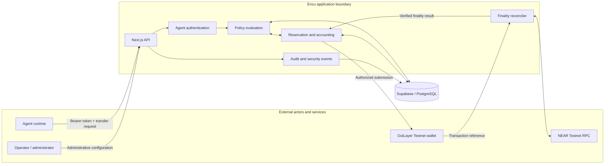

# Encu Architecture

This document describes the implemented V1 architecture. It distinguishes application-level controls from the custody and signing functions supplied by OutLayer.

## 1. System context



### Component responsibilities

| Component | Responsibility |
|---|---|
| Agent runtime | Requests a payment using its agent-scoped bearer credential. It does not choose its trusted identity or policy result. |
| Encu API | Validates request shape, authenticates the caller, applies rate limits and coordinates the transfer lifecycle. |
| Policy and reservation logic | Evaluates agent and treasury authority, recipient permission, emergency state, idempotency and autonomous allowance. |
| PostgreSQL | Persists policies, allocations, treasury exposure, reservations, audit and security events. Atomic database functions protect exposure invariants. |
| OutLayer | Supplies the configured Testnet wallet custody, signing and transaction-submission path. |
| NEAR RPC | Supplies transaction and finality evidence used to reconcile the submitted transfer. |
| Reconciler | Compares chain evidence with the reserved transfer and settles the ledger only on a match. |

## 2. Authorization and execution sequence

```mermaid
sequenceDiagram
    participant Agent as Agent runtime
    participant API as Encu API
    participant DB as PostgreSQL
    participant OL as OutLayer
    participant RPC as NEAR RPC
    Agent->>API: POST transfer + agent bearer token
    API->>API: Authenticate, validate and rate-limit
    API->>DB: Atomic policy evaluation and reservation
    DB->>DB: Check allocation, treasury, recipient, limits, stop and replay
    DB-->>API: Denied, review required, or authorized reservation
    alt Denied
        API-->>Agent: Policy denial; no provider submission
    else Review required
        API-->>Agent: awaiting_approval; reservation held
    else Authorized
        API->>DB: Revalidate policy and claim submission
        DB-->>API: Submission claim granted
        API->>OL: Submit native NEAR transfer
        OL-->>API: Provider response / transaction reference
        API-->>Agent: Submission lifecycle response
        API->>RPC: Query transaction and finality evidence
        RPC-->>API: Transaction evidence
        API->>API: Verify signer, recipient, action and exact amount
        API->>DB: Settle reservation exactly once
    end
```

A provider response is not proof of payment. The ledger remains reserved while the provider outcome is ambiguous. Settlement requires matching NEAR FINAL evidence.

## 3. Policy model

A request is evaluated against several independent constraints:

- **Identity:** the bearer token resolves to one active logical agent. An optional `expectedAgentId` must match that authenticated identity.
- **Agent authority:** the agent's allocation, per-transfer cap, rolling limits and autonomous allowance.
- **Recipient authority:** the exact NEAR account ID must be authorized for that agent.
- **Treasury authority:** aggregate spent plus reserved exposure must remain within the global treasury ceiling.
- **Global controls:** emergency stop and persistent request rate limits.
- **Replay control:** the same request ID and same payload are idempotent; reuse with a changed payload is rejected.

A newly created reservation is required before provider submission. Policy and recipient state are revalidated at the submission boundary to reduce time-of-check/time-of-use risk.

## 4. Accounting invariants and concurrency

The system tracks exposure as:

`treasury exposure = spent + reserved`

`agent exposure = spent + reserved`

The atomic reservation path must prevent concurrent agents from exceeding either the shared treasury ceiling or their individual allocations. Exposure paths use one consistent database lock order:

`treasury row → allocation row → reservation row`

A reservation is settled at most once. Unknown provider outcomes remain held for reconciliation; they are not optimistically released and must not be blindly resubmitted.

## 5. Trust boundaries and key handling

- Agent tokens identify logical agents and should be stored by the agent operator in a server-side secret manager.
- The administrator credential controls global configuration and must never be given to an agent.
- The Supabase service-role key and OutLayer API key remain server-side.
- Multiple logical agents share one configured OutLayer execution wallet and provider credential in V1. They do not have isolated custody or independent provider principals.
- OutLayer wallet-level policy is separate from Encu's application-level agent policy. The current integration does not manage or independently verify every provider-side policy setting.
- Encu does not currently verify a transfer-bound TEE attestation.

## 6. Implemented boundary

V1 supports native NEAR transfers on Testnet through OutLayer. It does not implement mainnet execution, independent customer custody, per-customer wallets, a native NEAR treasury contract, additional execution providers or independent TEE attestation verification.

Automated API and reconciliation suites use mocks. They establish behavior under their fixtures, not live provider semantics. See [Security Model](SECURITY_MODEL.md) for the evidence classification and threat analysis.
