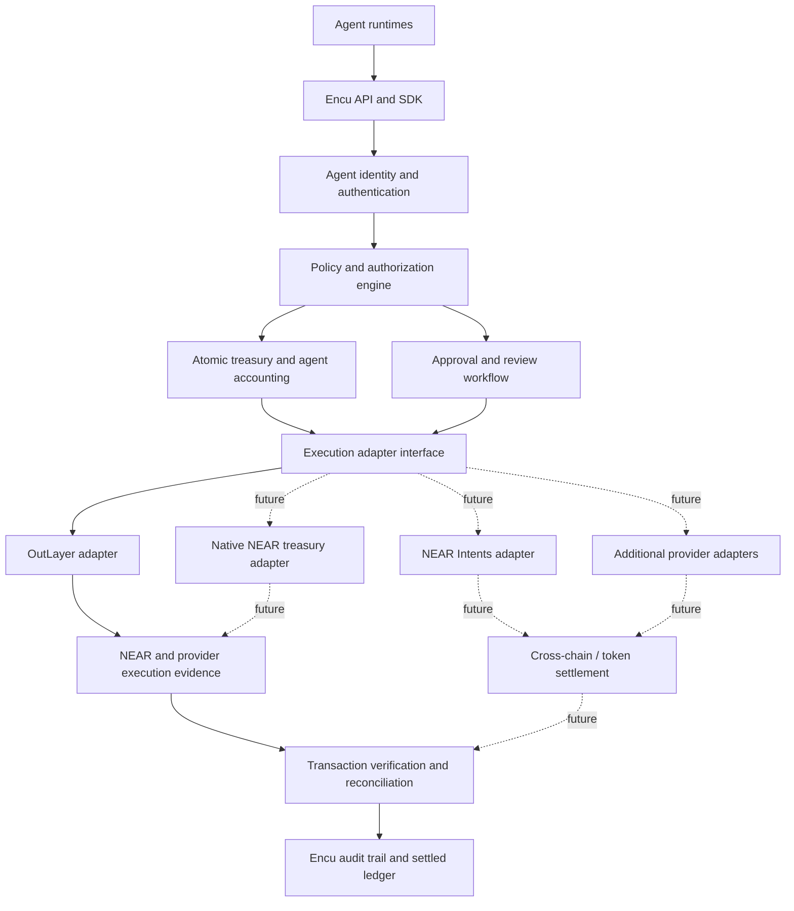

# Encu Product Vision and Roadmap

## Product vision

Encu is an independent authority and transaction-control layer for autonomous agents that need to move value.

An agent should not gain unrestricted spending power simply because it can access a wallet or call a payment provider. The system operating the agent should be able to define what that agent may spend, where it may send value, how much of a shared treasury it may consume, when a human must intervene, and what evidence is required before a payment is recorded as settled.

Encu's role is to enforce and account for that authority across agent identities and execution systems.

## The problem

Agent runtimes increasingly need to perform actions with financial consequences: paying suppliers, settling invoices, purchasing services, funding other agents and executing payment workflows. A wallet or provider may offer signing controls, but those controls do not necessarily represent the application-level authority of several independent agents sharing a common treasury.

The missing layer is attributable policy and accounting across the agent lifecycle:

- Which authenticated agent requested the payment?
- What allocation and spending limits apply to that agent?
- Is the exact destination authorized?
- Does the request fit within the shared treasury's remaining exposure?
- Does the request require approval?
- Has the provider submitted the transaction?
- Does the resulting on-chain transaction match the approved request?
- Has the payment reached the required finality state and been accounted for exactly once?

Encu is designed to own this policy and accounting layer while using specialized infrastructure for custody, signing, execution and settlement.

## Product principles

1. **Authority is independent of execution.** Agent identity, permissions, policy and accounting should not be defined solely by the wallet provider.
2. **Agent identity is explicit.** The authenticated credential determines the logical agent. A request body must not be able to impersonate another agent.
3. **Shared budgets are concurrency-safe.** Treasury and agent exposure must be reserved atomically before execution.
4. **Destinations are authorized explicitly.** A spending budget does not automatically authorize a new recipient.
5. **Approval is tied to policy.** Human intervention is used for requests outside configured autonomous authority or held for review.
6. **Submission is not settlement.** Provider acceptance and transaction hashes are intermediate evidence. Ledger settlement requires verification of the matching on-chain transaction and required finality.
7. **Providers are replaceable adapters.** A provider supplies execution capabilities; it should not own the entire Encu policy model.
8. **Security claims follow evidence.** Testnet prototypes, mocked tests, provider capabilities and independently verified on-chain outcomes must be described separately.

## What V1 implements

The current V1 is an application-layer gateway for native NEAR Testnet transfers. It includes:

- Supabase Auth developer workspaces and developer-owned logical agents;
- agent-scoped bearer authentication;
- per-agent allocations and transfer/rolling limits;
- a shared treasury ceiling and atomic reservation accounting;
- exact NEAR account recipient authorization;
- autonomous allowance and administrator approval handling;
- replay protection, emergency stop and persistent rate limiting;
- OutLayer-backed native NEAR Testnet submission;
- a separate NEAR reconciliation path that verifies finality, signer, receiver, native transfer action and exact amount;
- audit and security-event records.

V1 currently uses one configured OutLayer execution wallet and one server-side OutLayer API credential shared across logical agents. The agent identities and allocations are application-level controls, not separate custody accounts. V1 is not mainnet-ready and has not undergone an independent formal security audit.

See [Architecture](ARCHITECTURE.md), [Developer Guide](DEVELOPER_GUIDE.md) and [Security Model](SECURITY_MODEL.md) for implementation details and limitations.

## Architecture direction

The intended architecture separates the Encu control plane from execution and settlement adapters.

This is a target architecture, not a statement that all adapters or settlement paths exist in V1. The current implemented path is the OutLayer native NEAR Testnet adapter plus NEAR RPC reconciliation.

## Roadmap directions

The following items describe intended product direction. They are not delivery commitments or claims of implemented functionality.

### 1. Harden the current NEAR transfer gateway

- Complete repeatable hosted end-to-end verification against the exact release commit.
- Improve transaction-level observability across reservation, provider submission, provider status, transaction hash, NEAR finality and ledger settlement.
- Continue validating ambiguous provider outcomes, exact-once settlement and concurrency behavior.
- Document and verify the effective OutLayer wallet-level policy as a defense-in-depth boundary.
- Keep operator controls, audit evidence and developer integration behavior consistent with the actual backend.

### 2. Provider-independent execution interface

- Formalize a stable internal execution adapter contract.
- Keep policy evaluation, agent identity, recipient authorization and shared-budget reservations outside provider-specific code.
- Preserve provider-specific request references and execution states without allowing a provider response to settle Encu's ledger.
- Evaluate additional execution providers only where their custody, signing, transaction evidence and recovery semantics can be verified.

OutLayer remains the V1 execution provider. The adapter boundary is intended to prevent permanent coupling to one provider; it does not mean another provider is currently supported.

### 3. Native NEAR treasury and restricted agent authority

A future native NEAR treasury contract could move selected authorization guarantees on-chain. Areas for design and security review include:

- treasury-level spending ceilings and pause controls;
- per-agent allocations and authorized destinations;
- restricted function-call access rather than unrestricted account control;
- replay protection and explicit request identifiers;
- asynchronous transfer callbacks and exact-once off-chain settlement;
- clear ownership and recovery procedures.

This work is deferred from V1. A contract must independently enforce authority over funds held by its treasury account; it cannot simply mirror the current database ledger and be described as on-chain enforcement.

### 4. NEAR Intents and additional payment rails

A future integration may use NEAR Intents or other settlement infrastructure for swaps, token transfers and cross-chain payment flows.

Before such an integration is supported, Encu must bind the original authorization to the exact asset, amount, destination and relevant quote/route or execution artifact. It must verify that the operation executed matches what policy or an approver authorized. Provider documentation alone is not evidence that an Encu adapter exists.

The current V1 adapter does not call NEAR Intents endpoints. Intents-dependent OutLayer endpoints were documented as unavailable on Testnet because Testnet solvers were not available at the time this integration was scoped. This is not part of the current hackathon implementation.

### 5. Token and contract-based payments

Potential extensions include NEP-141 token transfers, payment and escrow contracts, DEX interactions and other NEAR contract calls. Each operation type requires a specific policy model and transaction verifier. Generic unrestricted contract-call support would undermine the explicit authorization model and is not assumed.

### 6. Verifiable execution and TEE evidence

OutLayer provides custody/signing infrastructure that includes TEE-related capabilities. A future Encu integration could expose execution attestations only if evidence is bound to the specific transfer and Encu can independently validate the relevant attestation chain and request details.

The current integration does not fetch, store or independently verify transfer-bound TEE attestations. Provider TEE capabilities must not be presented as an Encu verification feature.

### 7. Developer API and SDK

The current developer interface is a workspace and HTTP API for creating logical agents, configuring policy and submitting/reconciling requests. A future SDK could standardize agent registration, credential handling, payment requests, idempotency and lifecycle polling behind one developer-facing interface.

The intended integration pattern is:

1. A developer creates an Encu workspace and registers an agent.
2. The developer assigns that agent explicit spending authority and destinations.
3. The agent runtime stores its agent credential server-side.
4. The agent submits a payment request through the Encu API or future SDK.
5. Encu authorizes and reserves the request before execution.
6. The integration tracks the request until verified settlement or an explicit unresolved state.

This describes the intended developer experience. It does not imply that a published SDK, multi-provider routing or customer-specific custody is available today.

## Explicitly outside the current V1

- Mainnet execution.
- Independent custody wallets for each developer or logical agent.
- Multi-provider execution.
- Native NEAR treasury contract enforcement.
- NEAR Intents, cross-chain settlement and token/DEX/escrow integrations.
- Independent verification of transfer-bound TEE attestations.
- Production-grade multi-tenant custody and billing.
- Claims of independent formal security audit.

## Exploratory product opportunities

Agent operations management, agent-to-agent commerce, agent verification/attestation services and agent routing are adjacent opportunities. They are exploratory directions, not committed roadmap deliverables and not part of the current V1 scope.
